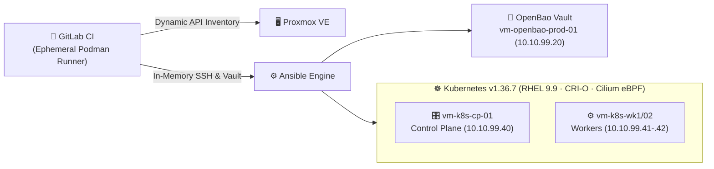

# ⚙️ Sovereign Configuration Management & Kubernetes Bootstrap (`pve-apps-configure`)


[](https://gitlab.com)
[](https://ansible.com)
[](https://kubernetes.io)
[](https://cri-o.io)
[](https://cilium.io)
[](https://openbao.org)

> **Zero-trust, idempotent Day-1/Day-2 configuration management** for a sovereign on-premise Proxmox VE infrastructure running **Red Hat Enterprise Linux 9.9 (SELinux Enforcing)**.

---

## 🏗️ Architecture Overview



---

## 🛡️ Security & Engineering Standards

* **Stateless CI/CD Execution:** Runs inside ephemeral rootless Podman containers. Proxmox API tokens and SSH keys are injected strictly into RAM (`ssh-agent` socket) and purged post-run.
* **Hardened RHEL 9.9 Baseline:** Enforces **SELinux (`Enforcing`)** with `container-selinux`, dedicated internal NTP sync (`10.10.99.1`), and asymmetric static routing across segmented VLANs (**VLAN 99 Mgmt** / **VLAN 10 Prod**).
* **OpenShift-Aligned Container Stack:** Deploys **Kubernetes `v1.36.7`** (`kubeadm`) on **CRI-O `1.36.9`** with YUM version locking (`exclude=`) and **Cilium eBPF + Envoy** CNI.
* **Dedicated Secrets Management (`OpenBao`):** Isolated external vault (`vm-openbao-prod-01`) with LVM-backed storage, 4096-bit RSA TLS, and hardened SSH access (disabled outside maintenance windows).

---

## 📂 Repository Structure

```text
├── .gitlab-ci.yml                  # Ephemeral Podman CI/CD pipeline
├── Dockerfile                      # Hardened Ansible execution environment
├── site.yml                        # Master multi-role playbook
├── inventory/proxmox.yml           # Dynamic Proxmox VE API inventory
└── roles/
    ├── openbao_setup/              # OpenBao provisioning, LVM storage & TLS hardening
    └── k8s_cluster/                # K8s 1.36 + CRI-O + Cilium CNI automated bootstrap
        ├── defaults/main.yml       # Single source of truth (IPs, VLANs, versions)
        └── tasks/                  # Modular OS, runtime, control-plane & worker tasks
```

---

## 🗺️ Roadmap

- [x] **OpenTofu IaC (`pve-infra-iac`):** Automated VM provisioning with GitLab-managed HTTP Remote State
- [x] **OpenBao:** Dedicated sovereign secrets vault deployment & TLS hardening
- [x] **Kubernetes Core:** RHEL 9.9 + CRI-O 1.36.9 + Kubernetes v1.36.7 + Cilium eBPF cluster
- [ ] **Cluster Add-ons:** MetalLB (VLAN 10 L2), Local Path Storage & External Secrets Operator (OpenBao sync)
- [ ] **GitOps Delivery:** AWX & ArgoCD deployment
